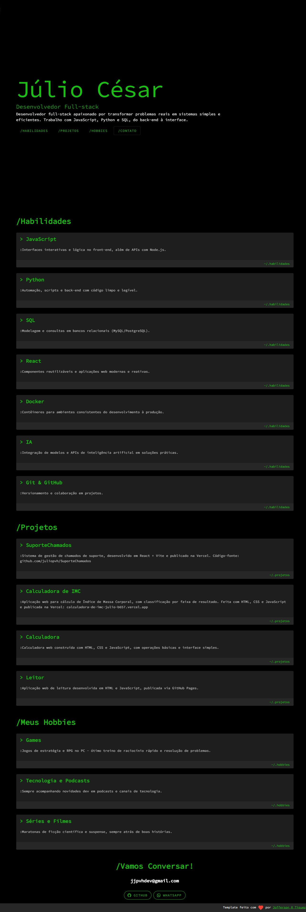

# 💻 Portfólio — Júlio César

> Desenvolvedor Full-stack

Meu portfólio pessoal, com estilo "terminal hacker": fundo preto, verde fosforescente e fonte monoespaçada.

## 🌐 Online

**[portifolio-mauve-five-10.vercel.app](https://portifolio-mauve-five-10.vercel.app)**



## 🧪 Tecnologias

- **HTML5 + CSS3** (Vuetify 2 via CDN)
- **Vue.js 2** — renderiza o conteúdo a partir de `config.js`
- **AOS** — animações de entrada
- **MDI Icons** — ícones (GitHub, WhatsApp, etc.)
- Publicado na **Vercel**

## 📂 Estrutura

```
├── index.html              # Página (estrutura e estilos)
├── config.js               # TODO o conteúdo: nome, bio, skills, projetos, hobbies e contatos
├── cursor.gif              # Cursor piscando no fundo
├── screenshot.jpg          # Print do site
└── favicon_package_v0.16/  # Ícones (favicon)
```

## ✏️ Como personalizar

Todo o conteúdo fica em **`config.js`** — não precisa mexer no HTML:

```js
window.PorfolioConfig = {
  name: 'Seu Nome',
  jobTitle: 'Seu cargo',
  jobDescription: 'Sua bio...',
  skills: [...],     // habilidades
  works: [...],      // projetos (nome, link e descrição)
  hobbies: [...],    // hobbies
  contacts: { email, links }  // e-mail + redes com ícone MDI (ex: 'mdi-github')
};
```

Para publicar mudanças, basta subir o `config.js` atualizado — a Vercel faz o deploy automático.

## 🚀 Como rodar localmente

É um site estático — basta abrir o `index.html` no navegador. Nada para instalar.

## 🙏 Créditos

Template [**Hacker**](https://github.com/OSSPhilippines/freefolio) do projeto [Freefolio — OSSPH](https://github.com/OSSPhilippines/freefolio), criado por [Jofferson R Tiquez](https://twitter.com/jrtiquez). Licença MIT.

---

⭐ Feito por **Júlio César** — [GitHub](https://github.com/juliopvh) · [WhatsApp](https://wa.me/5569992926605)
